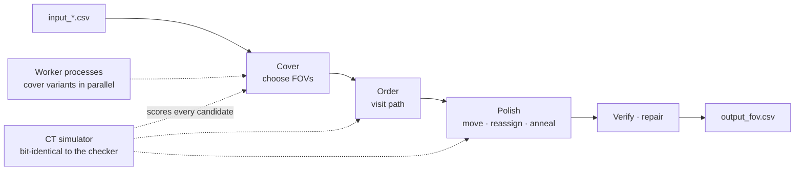

<div align="center">

# ARGOS · AOI Inspection Planning Solver

**Plans the shots of a PCB inspection machine so it takes fewer images and travels less, cutting the cycle time of every board**

The solver Team ARGOS submitted to the 4th Koh Young AI Competition (ICCAS 2026) — release R8.19, submitted on 2026-10-04.

[](LICENSE)

[한국어](README.md) · **English**

</div>

---

## Why we built it

An AOI machine moves its camera over the PCB, takes field-of-view images (FOVs), reconstructs them in 3D and inspects the parts on several cores. The cycle time of a board depends less on the machine than on the **inspection plan**. A plan decides three things:
- where to take each image
- which image inspects each part
- in what order to visit the images

The three are coupled. Fewer images, shorter paths and cores that never sit idle pull against each other. The contest score also adds the solver's own computation time, so searching longer costs points.

→ This solver replaces the guesswork with **one judge: an in-house simulator, bit-identical to the official checker, that scores every candidate plan directly**.

---

## Tech stack

| Area | Choice | Why |
|---|---|---|
| **Language** | Python 3.12 · NumPy · pandas | Same as the grading environment |
| **Speed** | numba | Hot loops compiled with results bit-identical to Python; a pure-Python path runs when numba is missing |
| **Parallelism** | multiprocessing (spawn) | Worker processes finish other cover variants at the same time; the best plan wins |
| **Checking** | built-in rule check | Every output is checked against the contest rules and repaired before it is written |

---

## How it works

For every part we compute the "feasible-centre rectangle": a FOV centre inside it keeps the whole part in the image. Planning becomes piercing all rectangles with as few points as possible.



**Design principles**
- **Judge by the real score only:** we re-implemented the checker's cycle-time computation (capture → reconstruction → inspection on k cores, plus core selection) with the same order of operations. Every candidate is scored by this simulator, and a change is kept only if it is strictly better.
- **Iterations, not the clock:** computation time is part of the score, so search budgets are fixed iteration counts with fixed seeds. The same input gives the same plan (except where a parallel worker's reply time changes the result).
- **Always a valid answer:** a trivial plan is written at the first moment and replaced atomically by better plans; a time limit always leaves a valid output.
- **Cheap decisions first, exact decisions last:** many candidates are filtered by a cheap proxy; the final choice uses the exact score.

**Stages**
- **Cover** minimises the number of FOVs: four greedy covers with different settings, and on lattice and camera-bound boards a weighted set-cover local search (RWLS) with 2-D dominance reduction removes even more.
- **Order** respects fiducials first, type order 2 → 1 → 0 and no step mixing, and picks among nearest-neighbour, 2-opt, Or-opt paths and structural candidates (heavy FOVs first, and so on) by real score.
- **Polish** collects what is left: centre refinement, heavy-part reassignment, release relocation, order annealing and re-splitting neighbouring FOV pairs.
- **Parallel portfolio:** worker processes started at import finish the other cover variants at the same time; the plan with the lowest exact score wins. The pool pauses and resumes when the machine is busy.

The detailed design of each stage, the reasons behind it and what we tried but did not adopt are in **[docs/ALGORITHM.en.md](docs/ALGORITHM.en.md)**.

---

## Example

> **Input:** official evaluation board `S00_sparse_fast_001` — PCB 312×246 mm, FOV 96×77 mm, 618 parts, at most 9 cores
>
> **Output (`output_fov.csv`, first rows):**
> ```
> ,x,y,comp_idx
> 0,9.5,14.5,[0]
> 1,48.800999999999995,23.038999999999998,"[270, 65, 144, 109, 568, ...]"
> 2,23.999,128.881,"[472, 98, 250, 147, 548, ...]"
> ```
> 32 FOVs, 6 cores, CT 36.16 s, 0.27 s of computation (official result)
>
> **Why it is valid:** the first row is the fiducial-only FOV, centred on the fiducial (9.5, 14.5). Row order is visit order, and the official checker passed both coverage and order.

---

## Measured results

From the official contest evaluation (96 hidden boards).

| Metric | Value |
|---|---|
| **Validity** | 96/96 boards pass coverage and order, 0 rule violations |
| **vs reference solver** | **−4.7%** on CT + 10k, better on 94 of 96 boards · mean FOVs 61.1 → **49.9** |
| **vs lower bound** | on average **2.16%** above a bound that no valid plan can beat |
| **Computation time** | 0.44 s per board on average |

---

## Features

| Feature | Description |
|---|---|
| Feasible-centre rectangles | Where a FOV centre may lie for each part; side-view parts use the half window, oversized parts a union of windows |
| Set-cover local search | RWLS removes and adds FOVs under changing weights to cut the FOV count |
| Dominance reduction | Drops candidate FOVs contained in others to build a smaller alternative cover |
| Rule-aware ordering | Fiducials first, types 2 → 1 → 0, no step mixing, with path optimisation inside the blocks |
| Exact CT simulator | Capture, reconstruction and inspection pipeline plus core selection, with the checker's arithmetic |
| Polishing | Centre shifts, heavy-part reassignment, order annealing, re-splitting neighbouring FOV pairs |
| Parallel portfolio | Workers solve cover variants concurrently; a CPU monitor pauses and resumes them |
| Self-check and repair | Every rule is checked before writing; violations are repaired conservatively |
| Atomic writes | An interrupted write never leaves a broken file; a failed write keeps the valid plan already on disk |
| numba-free path | Without numba (or if compilation fails) the same algorithms run as pure-Python kernels |

---

## Project structure

```
├── ARGOS/                  # the solver package (exactly as submitted)
│   ├── solver.py           #   entry point solve() · stage control · anytime writes
│   ├── geometry.py         #   input parsing · feasible-centre rectangles
│   ├── cover.py            #   greedy cover · redundant FOV removal
│   ├── setcover.py         #   set-cover local search (RWLS)
│   ├── setcover_py.py      #   the same kernels in pure Python
│   ├── order.py            #   visit order
│   ├── refine.py           #   small centre shifts
│   ├── assign.py           #   heavy-part reassignment
│   ├── anneal.py           #   order annealing · polishing
│   ├── polish_nb.py        #   compiled polishing loops
│   ├── release.py          #   moving the last inspection earlier
│   ├── release_tools.py    #   its scheduling helpers
│   ├── recover.py          #   re-splitting neighbouring FOV pairs
│   ├── ct_sim.py           #   CT simulator (the checker's arithmetic)
│   ├── acceleration.py     #   compiled simulator kernels
│   ├── verify.py           #   rule check · repair
│   ├── parallel.py         #   parallel portfolio workers
│   └── atomic_io.py        #   atomic writes
├── docs/ALGORITHM.en.md    # algorithm design document (Korean: ALGORITHM.md)
├── requirements.txt        # tested package versions (pinned)
├── LICENSE                 # CC BY-NC-SA 4.0
└── NOTICE.md               # contest material attribution and derived parts
```

---

## Getting started

### Run

Put the `ARGOS/` folder into the official contest repository (runner `2_run.py`, checker `utils/`, public data `simulation_data/`) and run it.

```bash
git clone https://github.com/iccas2026-kohyoung/contest
git clone https://github.com/Patrick-SCH03/kohyoung-ai-competition-2026-argos
cp -r kohyoung-ai-competition-2026-argos/ARGOS contest/
cd contest
pip install -r ../kohyoung-ai-competition-2026-argos/requirements.txt
python 2_run.py --solver ARGOS
```

| Item | Where | Note |
|---|---|---|
| Python | 3.12 | Same as the grading environment |
| Packages | `requirements.txt` | numpy 2.5.3 · pandas 3.0.6 · Rtree 1.4.1 · numba 0.67.0 · llvmlite 0.49.0 |
| Entry point | `ARGOS.solve(data_folder)` | writes `data_folder/output_fov.csv` and returns the FOV count |

---

## API

`ARGOS.solve(data_folder) -> int` writes `data_folder/output_fov.csv`. **Row order is visit order.**

| Key | Content |
|---|---|
| `x`, `y` | FOV centre (mm) |
| `comp_idx` | JSON list of the parts assigned to this FOV, dispatched to inspection cores in this order |

---

## Contributing

See **[CONTRIBUTING.md](CONTRIBUTING.md)** for commit conventions and how to contribute.

---

## Team ARGOS

| Member | GitHub |
|---|---|
| Patrick-SCH03 | [@Patrick-SCH03](https://github.com/Patrick-SCH03) |
| xjx06127 | [@xjx06127](https://github.com/xjx06127) |
| naeun211 | [@naeun211](https://github.com/naeun211) |
| rosuasu0721-cloud | [@rosuasu0721-cloud](https://github.com/rosuasu0721-cloud) |
| hoon0503 | [@hoon0503](https://github.com/hoon0503) |

---

## Notes

- **License:** CC BY-NC-SA 4.0. The simulator and rule-check files (`ct_sim.py`, `acceleration.py`, `release_tools.py`, `geometry.py`, `verify.py`) adapt the computations of the contest checker, which the organizers provide under the same license, so the whole repository is released under it. No commercial use. Details in [NOTICE.md](NOTICE.md).
- **No contest material:** data, checker, runner and reference solver are not included; get them from the official repository.
- **Unofficial:** this is not official code of Koh Young Technology or ICROS.
- **Limits:** no guarantee of global optimality. Computation time depends on the machine (cores, load), and worker timing can change plans slightly between runs on large boards.
