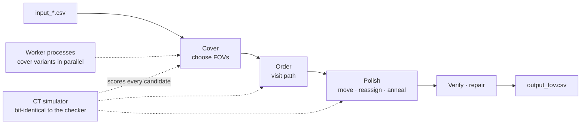

<div align="center">

# ARGOS · AOI Inspection Planning Solver

**Plans the shots of a PCB inspection machine so it takes fewer images and travels less, cutting the cycle time of every board**

Team ARGOS · the 4th Koh Young AI Competition (ICCAS 2026)

[](LICENSE)

[한국어](README.md) · **English**

</div>

---

## Why we built it

An AOI machine moves its camera over the PCB, takes field-of-view images (FOVs), reconstructs them in 3D and inspects the parts on several cores. The cycle time of a board depends less on the machine than on the **inspection plan**. A plan decides three things:
- where to take each image
- which image inspects each part
- in what order to visit the images

The three are coupled. Fewer images, shorter paths and cores that never sit idle pull against each other. The contest score also adds the solver's own computation time, so searching longer costs points.

→ This solver replaces the guesswork with **one judge: an in-house simulator, bit-identical to the official checker, that scores every candidate plan directly**.

---

## Tech stack

| Area | Choice | Why |
|---|---|---|
| **Language** | Python 3.12 · NumPy · pandas | Same as the grading environment |
| **Speed** | numba | Hot loops compiled with results bit-identical to Python; a pure-Python path runs when numba is missing |
| **Parallelism** | multiprocessing (spawn) | Worker processes finish other cover variants at the same time; the best plan wins |
| **Checking** | built-in rule check | Every output is checked against the contest rules and repaired before it is written |

---

## How it works

For every part we compute the "feasible-centre rectangle": a FOV centre inside it keeps the whole part in the image. Planning becomes piercing all rectangles with as few points as possible.



**Design principles**
- **Judge by the real score only:** we re-implemented the checker's cycle-time computation (capture → reconstruction → inspection on k cores, plus core selection) with the same order of operations. Every candidate is scored by this simulator, and a change is kept only if it is strictly better.
- **Iterations, not the clock:** computation time is part of the score, so search budgets are fixed iteration counts with fixed seeds. The same input gives the same plan (except where a parallel worker's reply time changes the result).
- **Always a valid answer:** a trivial plan is written at the first moment and replaced atomically by better plans; a time limit always leaves a valid output.
- **Cheap decisions first, exact decisions last:** many candidates are filtered by a cheap proxy; the final choice uses the exact score.

**Stages**
- **Cover** minimises the number of FOVs: four greedy covers with different settings, and on lattice and camera-bound boards a weighted set-cover local search (RWLS) with 2-D dominance reduction removes even more.
- **Order** respects fiducials first, type order 2 → 1 → 0 and no step mixing, and picks among nearest-neighbour, 2-opt, Or-opt paths and structural candidates (heavy FOVs first, and so on) by real score.
- **Polish** collects what is left: centre refinement, heavy-part reassignment, release relocation, order annealing and re-splitting neighbouring FOV pairs.
- **Parallel portfolio:** worker processes started at import finish the other cover variants at the same time; the plan with the lowest exact score wins. The pool pauses and resumes when the machine is busy.

The detailed design of each stage, the reasons behind it and what we tried but did not adopt are in **[docs/ALGORITHM.en.md](docs/ALGORITHM.en.md)**.

---

## Example

> **Input:** official evaluation board [`S00_sparse_fast_001`](contest/evaluation_data/S00_sparse_fast_001) — PCB 312×246 mm, FOV 96×77 mm, 618 parts, at most 9 cores
>
> **Output (`output_fov.csv`, first rows):**
> ```
> ,x,y,comp_idx
> 0,9.5,14.5,[0]
> 1,48.800999999999995,23.038999999999998,"[270, 65, 144, 109, 568, ...]"
> 2,23.999,128.881,"[472, 98, 250, 147, 548, ...]"
> ```
> 32 FOVs, 6 cores, CT 36.16 s, 0.27 s of computation (official result)
>
> **Why it is valid:** the first row is the fiducial-only FOV, centred on the fiducial (9.5, 14.5). Row order is visit order, and the official checker passed both coverage and order.

---

## Measured results

From the official contest evaluation (96 evaluation boards, hidden during the contest).

| Metric | Value |
|---|---|
| **Official ranking** | **3rd** of 13 (reference solver included) · Total 13,351.1 |
| **Validity** | 96/96 boards pass coverage and order, 0 rule violations |
| **vs reference solver** | **−4.7%** on CT + 10k, better on 94 of 96 boards · mean FOVs 61.1 → **49.9** |
| **vs lower bound** | on average **2.16%** above a bound that no valid plan can beat |
| **Computation time** | 0.44 s per board on average |

The evaluation boards and the official outputs are in [`contest/evaluation_data/`](contest/evaluation_data) and the summary in [`contest/evaluation_results/`](contest/evaluation_results), so the results can be re-scored as they are ([Getting started](#getting-started)).

---

## How we experimented

- **Checker first:** we re-implemented the CT computation of the published checker ([`contest/utils/checker.py`](contest/utils/checker.py)) with the same order of operations and confirmed identical values before writing the solver. Every later decision was judged by this simulator.
- **Judged on new boards:** the 96 public boards were for development only. Adoption was decided on hundreds of fresh boards from the official generator (`1_generate_data.py`), to avoid tuning to the hidden set.
- **Paired runs and pre-set gates:** candidate and baseline ran alternately on the same boards and machine, compared board by board. The adoption criteria (gain, worst board, validity, determinism, computation time) were written down before each experiment.
- **Measure the ceiling first:** before building an idea, an oracle experiment measured the most it could gain. This is why exact minimum cover (integer programming) was left out ([docs/ALGORITHM.en.md §10](docs/ALGORITHM.en.md)).
- **Grading environment and failures:** results were cross-checked under the grading server's conditions (Windows 11, Python 3.12) and in a Linux container, and we confirmed a valid output survives a forced kill, a failed write and a missing numba.
- **Rebuttal and records:** every conclusion went through an independent reviewer's rebuttal, and only reproducible points were adopted. More than 300 experiments, failures included, are kept in a ledger.

---

## Use in the field and next steps

**Use**
- **Automatic inspection programs:** from the part coordinates of a new PCB model it builds the FOV layout, visit order and core count in 0.44 s per board on average. It replaces hand-made shot plans, and a shorter cycle time per board raises line throughput.
- **Comparing machine specs:** change speed, acceleration, core count or reconstruction time in the simulator and the cycle time of the same board is computed at once, so the effect of extra cores or a new configuration can be compared before deployment.
- **Frequent model changes:** planning is fast and the same input gives the same plan, so high-mix lines can re-plan at every model change.
- **Safe to embed:** a valid plan exists at every moment, and only plans that pass the rule check are written.

**Next steps**
- **Calibration:** fit the simulator constants to travel, capture and reconstruction times logged on real machines to close the gap between the contest model and the machine.
- **Cover quality:** most of the remaining room is in the number of FOVs (+2.16% over the lower bound). Offline teaching, which has time to spare, could switch on exact minimum cover.
- **Field conditions:** add dual lanes or multiple heads, per-part inspection priority and re-shooting to the simulator and the objective.
- **Learning:** let a learned ordering model produce the first plan quickly, then polish it with exact simulator scores to cut computation time on large boards.
- **Other processes:** the same structure, piercing regions with points plus pipeline scheduling, applies to solder paste inspection (SPI), 3D measurement and laser marking path planning.

---

## Features

| Feature | Description |
|---|---|
| Feasible-centre rectangles | Where a FOV centre may lie for each part; side-view parts use the half window, oversized parts a union of windows |
| Set-cover local search | RWLS removes and adds FOVs under changing weights to cut the FOV count |
| Dominance reduction | Drops candidate FOVs contained in others to build a smaller alternative cover |
| Rule-aware ordering | Fiducials first, types 2 → 1 → 0, no step mixing, with path optimisation inside the blocks |
| Exact CT simulator | Capture, reconstruction and inspection pipeline plus core selection, with the checker's arithmetic |
| Polishing | Centre shifts, heavy-part reassignment, order annealing, re-splitting neighbouring FOV pairs |
| Parallel portfolio | Workers solve cover variants concurrently; a CPU monitor pauses and resumes them |
| Self-check and repair | Every rule is checked before writing; violations are repaired conservatively |
| Atomic writes | An interrupted write never leaves a broken file; a failed write keeps the valid plan already on disk |
| numba-free path | Without numba (or if compilation fails) the same algorithms run as pure-Python kernels |

---

## Project structure

```
├── ARGOS/                  # the solver package (exactly as submitted)
│   ├── solver.py           #   entry point solve() · stage control · anytime writes
│   ├── geometry.py         #   input parsing · feasible-centre rectangles
│   ├── cover.py            #   greedy cover · redundant FOV removal
│   ├── setcover.py         #   set-cover local search (RWLS)
│   ├── setcover_py.py      #   the same kernels in pure Python
│   ├── order.py            #   visit order
│   ├── refine.py           #   small centre shifts
│   ├── assign.py           #   heavy-part reassignment
│   ├── anneal.py           #   order annealing · polishing
│   ├── polish_nb.py        #   compiled polishing loops
│   ├── release.py          #   moving the last inspection earlier
│   ├── release_tools.py    #   its scheduling helpers
│   ├── recover.py          #   re-splitting neighbouring FOV pairs
│   ├── ct_sim.py           #   CT simulator (the checker's arithmetic)
│   ├── acceleration.py     #   compiled simulator kernels
│   ├── verify.py           #   rule check · repair
│   ├── parallel.py         #   parallel portfolio workers
│   └── atomic_io.py        #   atomic writes
├── contest/                # contest material (files of the official repository, unchanged)
│   ├── 2_run.py            #   runner · scoring (--eval re-scores saved outputs)
│   ├── utils/              #   official checker checker.py · data generator
│   ├── simulation_data/    #   public practice data, 96 boards
│   ├── evaluation_data/    #   official evaluation data, 96 boards + ARGOS and reference outputs per board
│   ├── evaluation_results/ #   official evaluation summary · per-board results
│   ├── ky_solver/          #   reference solver (compiled, Python 3.12 Windows)
│   └── *.html              #   contest rules · data description · guide · Q&A
├── docs/ALGORITHM.en.md    # algorithm design document (Korean: ALGORITHM.md)
├── requirements.txt        # tested package versions (pinned)
├── LICENSE                 # CC BY-NC-SA 4.0
└── NOTICE.md               # contest material attribution and derived parts
```

---

## Getting started

### Run

The contest material is in `contest/`, so this repository runs on its own. The runner imports solvers from its own folder, so copy `ARGOS/` into `contest/`.

```bash
git clone https://github.com/Patrick-SCH03/kohyoung-ai-competition-2026-argos
cd kohyoung-ai-competition-2026-argos
pip install -r requirements.txt
cp -r ARGOS contest/
cd contest
python 2_run.py --solver ARGOS                          # public practice data, 96 boards
python 2_run.py --solver ARGOS --data evaluation_data   # official evaluation data, 96 boards
```

To re-score the outputs from the official evaluation as they are, use `--eval`. Running the solver again overwrites the official outputs in `evaluation_data/<board>/ARGOS/`, so re-score first (restore with `git checkout -- contest/evaluation_data`).

```bash
python 2_run.py --solver ARGOS --data evaluation_data --eval   # official ARGOS outputs
python 2_run.py --solver ky --data evaluation_data --eval      # reference solver outputs
```

| Item | Where | Note |
|---|---|---|
| Python | 3.12 | Same as the grading environment |
| Packages | `requirements.txt` | numpy 2.5.3 · pandas 3.0.6 · Rtree 1.4.1 · numba 0.67.0 · llvmlite 0.49.0 |
| Entry point | `ARGOS.solve(data_folder)` | writes `data_folder/output_fov.csv` and returns the FOV count |

---

## API

`ARGOS.solve(data_folder) -> int` writes `data_folder/output_fov.csv`. **Row order is visit order.**

| Key | Content |
|---|---|
| `x`, `y` | FOV centre (mm) |
| `comp_idx` | JSON list of the parts assigned to this FOV, dispatched to inspection cores in this order |

---

## Contributing

See **[CONTRIBUTING.md](CONTRIBUTING.md)** for commit conventions and how to contribute.

---

## Team ARGOS

| Member | GitHub |
|---|---|
| Patrick-SCH03 | [@Patrick-SCH03](https://github.com/Patrick-SCH03) |
| xjx06127 | [@xjx06127](https://github.com/xjx06127) |
| naeun211 | [@naeun211](https://github.com/naeun211) |
| rosuasu0721-cloud | [@rosuasu0721-cloud](https://github.com/rosuasu0721-cloud) |
| hoon0503 | [@hoon0503](https://github.com/hoon0503) |

---

## Notes

- **License:** CC BY-NC-SA 4.0. The simulator and rule-check files (`ct_sim.py`, `acceleration.py`, `release_tools.py`, `geometry.py`, `verify.py`) adapt the computations of the contest checker, which the organizers provide under the same license, so the whole repository is released under it. No commercial use. Details in [NOTICE.md](NOTICE.md).
- **Contest material:** the data, checker, runner, reference solver and documents in `contest/` are the material Koh Young Technology provides under CC BY-NC-SA 4.0, included unchanged. Source and scope are in [contest/SOURCE.md](contest/SOURCE.md).
- **Unofficial:** this is not official code of Koh Young Technology or ICROS.
- **Limits:** no guarantee of global optimality. Computation time depends on the machine (cores, load), and worker timing can change plans slightly between runs on large boards.
