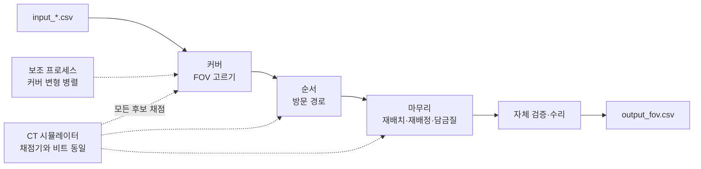

<div align="center">

# ARGOS · AOI 촬영 계획 솔버

**PCB 검사 장비가 사진을 덜 찍고 덜 움직이도록 촬영 계획을 짜서, 보드당 검사 시간을 줄입니다**

제4회 고영 AI 경진대회(ICCAS 2026) 팀 ARGOS가 제출한 솔버입니다(R8.19, 2026-10-04 제출).

[](LICENSE)

**한국어** · [English](README.en.md)

</div>

---

## 왜 만들었나

AOI 장비는 카메라를 PCB 위로 옮기며 사진(FOV)을 찍고, 3D 복원과 부품 검사를 여러 코어에서 나눠 처리합니다. 보드 한 장의 검사 시간(Cycle Time)은 장비보다 **촬영 계획**이 좌우합니다. 촬영 계획은 세 가지를 정합니다.
- 어디를 찍을지
- 각 부품을 어느 사진에 맡길지
- 어떤 순서로 돌지

세 문제는 서로 얽혀 있습니다. 사진 수를 줄이는 커버, 이동을 줄이는 순서, 검사 코어가 놀지 않게 하는 배정이 서로 부딪힙니다. 대회 점수에는 솔버의 계산 시간도 더해지므로, 오래 탐색할수록 손해입니다.

→ 이 솔버는 계획을 고르는 과정을 **채점기와 비트까지 같은 자체 시뮬레이터로 모든 후보를 직접 채점하는 방식**으로 대체합니다.

---

## 기술 스택

| 영⁠역 | 선택 | 이유 |
|---|---|---|
| **언⁠어** | Python 3.12 · NumPy · pandas | 대회 채점 환경과 같습니다 |
| **가⁠속** | numba | 핵심 반복문을 파이썬 결과와 비트까지 같게 컴파일합니다. numba가 없으면 순수 파이썬 경로로 돕니다 |
| **병⁠렬** | multiprocessing(spawn) | 커버 변형 여러 개를 보조 프로세스에서 동시에 끝까지 풀고 가장 좋은 것을 고릅니다 |
| **검⁠증** | 자체 규칙 검사 | 출력마다 대회 규칙으로 스스로 검사하고, 어긋나면 고친 뒤 저장합니다 |

---

## 어떻게 동작하나

부품마다 "FOV 중심이 이 안에 있으면 그 부품이 사진에 다 들어가는 사각형"을 만들고, 이 사각형들을 적은 점으로 모두 찌르는 문제로 계획을 세웁니다.



**설계 원칙**
- **실제 점수로만 판정:** 채점기의 사이클 타임 계산(촬영 → 복원 → k개 코어 검사, 코어 수 선택)을 같은 연산 순서로 다시 구현했습니다. 모든 후보를 이 시뮬레이터로 채점하고, 엄격히 좋아질 때만 바꿉니다.
- **시간 대신 반복 횟수:** 계산 시간도 점수라서 탐색 예산을 반복 횟수와 고정 시드로 정합니다. 같은 입력이면 같은 계획이 나옵니다(병렬 작업자 응답 시점이 바꾸는 경우만 예외).
- **언제든 유효한 답:** 첫 순간에 자명한 계획을 쓰고, 더 좋은 계획이 나올 때마다 원자적으로 바꿉니다. 시간 제한에 끊겨도 유효한 출력이 남습니다.
- **싼 판단 → 비싼 판단:** 후보가 많으면 싼 대리 지표로 거르고, 최종 선택은 정확한 점수로 합니다.

**단계**
- **커버**는 FOV 수를 줄입니다. 설정이 다른 탐욕 커버 4개를 만들고, 격자 보드와 카메라 병목 보드에서는 집합 덮개 지역탐색(RWLS)과 2차원 지배 축소로 한 장이라도 더 줄입니다.
- **순서**는 피듀셜 우선·타입 순서(2→1→0)·단차 규칙을 지키며, 최근접·2-opt·Or-opt 경로와 구조 후보(무거운 FOV 먼저 등) 중 실제 점수가 가장 좋은 것을 고릅니다.
- **마무리**는 중심 미세 이동, 무거운 부품 재배정, 해제 시점 당기기, 순서 담금질, 이웃 FOV 쌍 다시 나누기로 남은 이득을 줍습니다.
- **병렬 포트폴리오:** import 때 띄운 보조 프로세스가 나머지 커버 변형을 동시에 끝까지 풀고, 정확한 점수가 가장 낮은 계획을 고릅니다. 기계가 바쁘면 스스로 멈췄다가 다시 켭니다.

각 단계의 자세한 설계와 이유, 시도했지만 넣지 않은 것은 **[docs/ALGORITHM.md](docs/ALGORITHM.md)** 에 있습니다.

---

## 실제 예시

> **입력:** 공식 평가 보드 `S00_sparse_fast_001` — PCB 312×246 mm, FOV 96×77 mm, 부품 618개, 최대 코어 9
>
> **출력 (`output_fov.csv` 앞부분):**
> ```
> ,x,y,comp_idx
> 0,9.5,14.5,[0]
> 1,48.800999999999995,23.038999999999998,"[270, 65, 144, 109, 568, ...]"
> 2,23.999,128.881,"[472, 98, 250, 147, 548, ...]"
> ```
> FOV 32장, 코어 6개, CT 36.16초, 계산 0.27초 (공식 채점 결과)
>
> **근거:** 첫 행은 피듀셜 전용 FOV이고 중심이 피듀셜 중심(9.5, 14.5)과 같습니다. 행 순서가 곧 방문 순서이며, 공식 checker가 커버와 순서를 모두 통과로 판정했습니다.

---

## 측정된 결과

대회 공식 평가(비공개 평가셋 96보드) 기준입니다.

| 지⁠표 | 값 |
|---|---|
| **유⁠효성** | 96/96 보드 커버·순서 통과, 규칙 위반 0 |
| **참⁠조 솔⁠버 대⁠비** | CT + 10k 기준 **−4.7%**, 96보드 중 94보드에서 더 좋음 · 평균 FOV 61.1 → **49.9장** |
| **이⁠론 하⁠한 대⁠비** | 어떤 유효한 계획도 넘을 수 없는 하한보다 평균 **2.16%** 높음 |
| **계⁠산 시⁠간** | 보드당 평균 0.44초 |

---

## 주요 기능

| 기⁠능 | 설명 |
|---|---|
| 허용 중심 사각형 | 부품마다 FOV 중심이 놓일 수 있는 영역을 계산합니다. 옆면 촬영 부품은 절반 FOV, 큰 부품은 여러 FOV의 합집합으로 덮습니다 |
| 집합 덮개 지역탐색 | 가중치를 바꿔 가며 FOV를 빼고 넣는 RWLS로 FOV 수를 줄입니다 |
| 2차원 지배 축소 | 다른 후보에 포함되는 후보 FOV를 지워 탐색 공간을 줄인 대안 커버를 만듭니다 |
| 규칙을 지키는 순서 | 피듀셜 우선, 타입 2→1→0, 단차 혼합 금지를 지키며 경로를 최적화합니다 |
| 정확한 CT 시뮬레이터 | 촬영·복원·검사 파이프라인과 코어 수 선택을 채점기와 같은 산술로 계산합니다 |
| 다듬기 | 중심 미세 이동, 무거운 부품 재배정, 순서 담금질, 이웃 FOV 쌍 다시 나누기 |
| 병렬 포트폴리오 | 보조 프로세스가 커버 변형을 동시에 풀고, 부하 감시로 멈춤·재개합니다 |
| 자체 검증·수리 | 저장 전에 모든 규칙을 검사하고, 어긋나면 보수적으로 고칩니다 |
| 원자적 저장 | 쓰는 도중 끊겨도 깨진 파일이 남지 않습니다. 저장이 실패해도 이미 쓴 유효한 계획을 지킵니다 |
| numba 없는 경로 | numba가 없거나 컴파일에 실패하면 같은 알고리즘의 순수 파이썬 커널로 돕니다 |

---

## 프로젝트 구조

```
├── ARGOS/                  # 솔버 패키지 (대회에 제출한 그대로)
│   ├── solver.py           #   진입점 solve() · 단계 조율 · 선기록
│   ├── geometry.py         #   입력 파싱 · 허용 중심 사각형
│   ├── cover.py            #   탐욕 커버 · 중복 FOV 제거
│   ├── setcover.py         #   집합 덮개 지역탐색(RWLS)
│   ├── setcover_py.py      #   같은 커널의 순수 파이썬판
│   ├── order.py            #   방문 순서
│   ├── refine.py           #   중심 미세 이동
│   ├── assign.py           #   무거운 부품 재배정
│   ├── anneal.py           #   순서 담금질 · 다듬기
│   ├── polish_nb.py        #   다듬기 컴파일 루프
│   ├── release.py          #   마지막 검사를 앞당기는 이동
│   ├── release_tools.py    #   그 일정 계산 도우미
│   ├── recover.py          #   이웃 FOV 쌍 다시 나누기
│   ├── ct_sim.py           #   CT 시뮬레이터 (채점 산술)
│   ├── acceleration.py     #   시뮬레이터 컴파일 커널
│   ├── verify.py           #   자체 규칙 검사 · 수리
│   ├── parallel.py         #   병렬 포트폴리오 작업자
│   └── atomic_io.py        #   원자적 저장
├── docs/ALGORITHM.md       # 알고리즘 설계 문서 (영문: ALGORITHM.en.md)
├── requirements.txt        # 시험한 패키지 판 (버전 고정)
├── LICENSE                 # CC BY-NC-SA 4.0
└── NOTICE.md               # 대회 자료 출처와 파생 부분
```

---

## 시작하기

### 실행

대회 공식 저장소(실행기 `2_run.py`, 채점기 `utils/`, 공개 데이터 `simulation_data/`) 위에 `ARGOS/` 폴더를 넣고 실행합니다.

```bash
git clone https://github.com/iccas2026-kohyoung/contest
git clone https://github.com/Patrick-SCH03/kohyoung-ai-competition-2026-argos
cp -r kohyoung-ai-competition-2026-argos/ARGOS contest/
cd contest
pip install -r ../kohyoung-ai-competition-2026-argos/requirements.txt
python 2_run.py --solver ARGOS
```

| 값 | 어디에 | 비고 |
|---|---|---|
| Python | 3.12 | 대회 채점 환경과 같습니다 |
| 패키지 | `requirements.txt` | numpy 2.5.3 · pandas 3.0.6 · Rtree 1.4.1 · numba 0.67.0 · llvmlite 0.49.0 |
| 진입점 | `ARGOS.solve(data_folder)` | `data_folder/output_fov.csv`를 쓰고 FOV 수를 돌려줍니다 |

---

## API

`ARGOS.solve(data_folder) -> int`는 `data_folder/output_fov.csv`를 씁니다. **행 순서가 곧 방문 순서**입니다.

| 키 | 내용 |
|---|---|
| `x`, `y` | FOV 중심 좌표(mm) |
| `comp_idx` | 이 FOV에 맡긴 부품 번호의 JSON 리스트. 나열 순서대로 검사 코어에 배정됩니다 |

---

## 개발 컨벤션

커밋 메시지 규칙과 기여 방법은 **[CONTRIBUTING.md](CONTRIBUTING.md)** 를 참고하세요.

---

## 팀 ARGOS

| 팀⁠원 | GitHub |
|---|---|
| Patrick-SCH03 | [@Patrick-SCH03](https://github.com/Patrick-SCH03) |
| xjx06127 | [@xjx06127](https://github.com/xjx06127) |
| naeun211 | [@naeun211](https://github.com/naeun211) |
| rosuasu0721-cloud | [@rosuasu0721-cloud](https://github.com/rosuasu0721-cloud) |
| hoon0503 | [@hoon0503](https://github.com/hoon0503) |

---

## 주의

- **라이선스:** CC BY-NC-SA 4.0입니다. 시뮬레이터·규칙 검사(`ct_sim.py`, `acceleration.py`, `release_tools.py`, `geometry.py`, `verify.py`)는 대회가 같은 라이선스로 제공한 채점기의 계산을 옮긴 부분이 있어 저장소 전체를 같은 조건으로 공개합니다. 상업적으로 쓸 수 없습니다. 자세한 출처는 [NOTICE.md](NOTICE.md)에 있습니다.
- **대회 자료 미포함:** 데이터, 채점기, 실행기, 참조 솔버는 넣지 않았습니다. 공식 저장소에서 받습니다.
- **비공식:** 고영테크놀러지·ICROS의 공식 코드가 아닙니다.
- **한계:** 전역 최적을 보장하지 않습니다. 계산 시간은 실행 환경(코어 수, 부하)에 따라 달라지고, 병렬 작업자 타이밍 때문에 큰 보드에서는 실행마다 계획이 조금 다를 수 있습니다.
